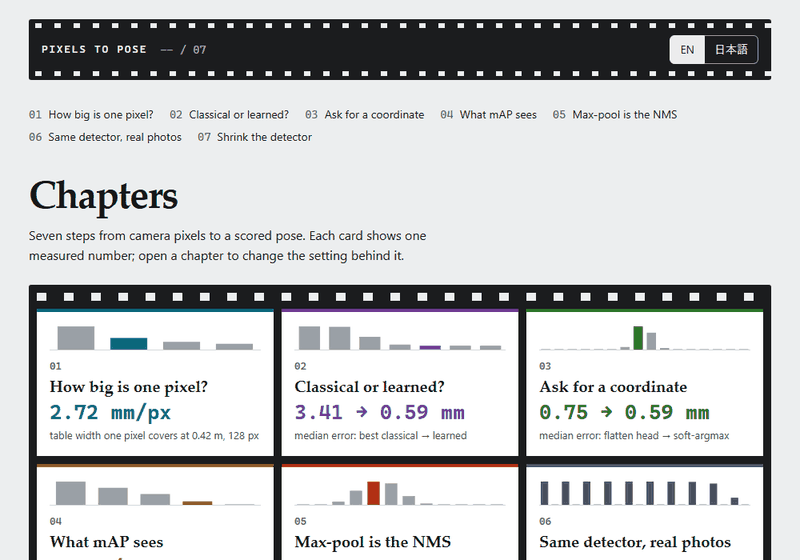

# Pixels to Pose

**Live: https://pixels-to-pose.vercel.app** · English / 日本語

How a robot turns camera pixels into a scored pose, in seven chapters where every number is measured. For example, a 27k-parameter soft-argmax head finds the cube to 0.59 mm median error.

| Chapter | Measured number on its card |
|---|---|
| 1. How big is one pixel? | 2.72 mm/px: table width one pixel covers at 0.42 m, 128 px |
| 2. Classical or learned? | 3.41 → 0.59 mm median error, best classical → learned |
| 3. Ask for a coordinate | 0.75 → 0.59 mm median error, flatten head → soft-argmax |
| 4. What mAP sees | 0.69 / 0.14 AP50 / mAP for a 7 px box shift |
| 5. Max-pool is the NMS | 0.18 ms to decode peaks with a max-pool |
| 6. Same detector, real photos | 0.91 → 0.01 mAP, renders → real photos |
| 7. Shrink the detector | 2.6× faster with INT8, one CPU thread |

The numbers come from [mujoco-cube-pose-cnn](https://github.com/AungKaung1928/mujoco-cube-pose-cnn) and [mujoco-clutter-detect](https://github.com/AungKaung1928/mujoco-clutter-detect), plus Levine et al. 2016 (spatial softmax, [arXiv 1504.00702](https://arxiv.org/abs/1504.00702)) and Zhou et al. 2019 (CenterNet, [arXiv 1904.07850](https://arxiv.org/abs/1904.07850)). Tests keep the page, this README and the data in agreement.

MIT licence.
